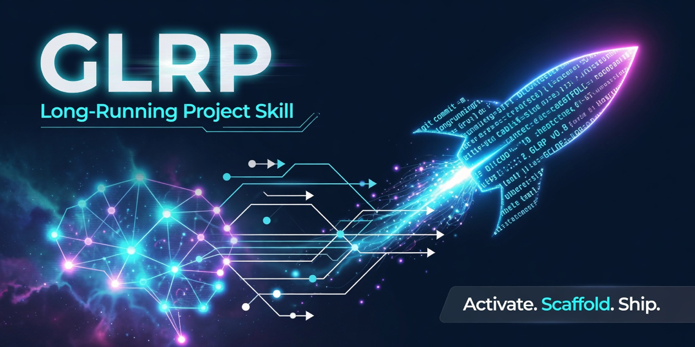
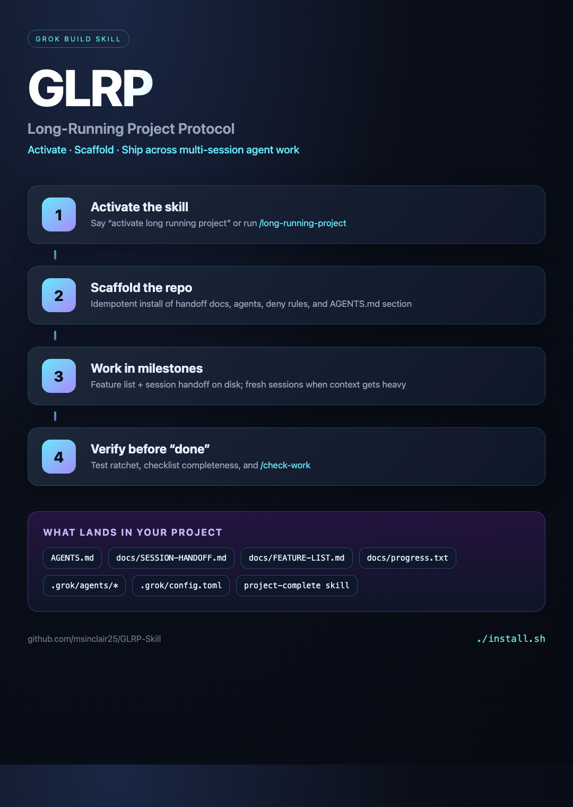

> **Deprecated.** Use **[msinclair25/glrp](https://github.com/msinclair25/glrp)** instead.
>
> Long coding sessions with Grok keeps dying. The new skill writes the plan as a numbered list, does one step, runs a real test, writes down the next step. Next chat reads that file and keeps going.
>
> Do not run this playbook and the new skill on the same project.

# GLRP Skill

<p align="center">
  
</p>

**Grok Long-Running Project** — a [Grok Build](https://docs.x.ai/build/overview) skill that turns any repo into a durable, multi-session agentic coding workspace.

Say this in a Grok session (from your project directory):

```text
activate long running project
```

or:

```text
/long-running-project
```

GLRP scaffolds the files and conventions that keep coding agents effective over **hours and days**: external handoff state, feature checklists, thin shared `AGENTS.md` rules, multi-agent profiles, safety denies, and a completeness ritual — without pasting a giant playbook into every prompt.

<p align="center">
  
</p>

---


> **Share image for X:** use [`docs/assets/social-preview.png`](docs/assets/social-preview.png) (HTML/CSS export — not a generative AI image). The older Imagine render is kept as `social-preview-ai.png` if you want it.

## Why this exists

Long agent sessions fail in predictable ways:

| Failure | GLRP response |
|---------|----------------|
| Context fills / agent “forgets” | `docs/SESSION-HANDOFF.md` + fresh sessions |
| “Done” when work is incomplete | Checklists, project verification, `/project-complete`, feature list |
| Fat always-on rules hurt quality | Thin managed `AGENTS.md` section only |
| Parallel agents collide | Worktree-aware roles under `.grok/agents/` |
| Tests deleted to go green | **Test ratchet** in shared rules |
| Re-explaining the protocol every repo | One skill install → activate per project |

The full design notes live in [`docs/PLAYBOOK.md`](docs/PLAYBOOK.md).

---

## Requirements

- [Grok Build CLI](https://x.ai/cli) (skill discovery under `${GROK_HOME:-$HOME/.grok}/skills/`)
- Python 3.9+ (for the scaffold script)
- Git (recommended; used to resolve project root)

### Grok 4.7 compatibility

This release is verified against **Grok Build CLI 1.0.41** and its **Grok 4.7** / **Grok 4.7 Build Fast** model entries. Grok Build's live catalog is authoritative for its model limits, so use `grok models` or `/context` instead of hard-coding an API context size. The public Grok 4.7 API documentation currently advertises a 500k context window; Grok Build may expose a different session limit.

---

## Install

**Copy-paste one line** (macOS, Linux, Windows Git Bash / WSL, or Grok Build):

```bash
glrp_tmp="$(mktemp -d)" && (trap 'rm -rf "$glrp_tmp"' EXIT; git clone --depth 1 https://github.com/msinclair25/GLRP-Skill.git "$glrp_tmp/GLRP-Skill" && bash "$glrp_tmp/GLRP-Skill/install.sh")
```

That clones the repo, installs into `${GROK_HOME:-$HOME/.grok}/skills/long-running-project/`, adds a short pointer in a regular Grok-home `AGENTS.md` if needed (symlinks are left alone), then removes the temp clone.

### Fastest safe path (one Grok start)

Scaffold directly after installing, review the diff, then start Grok once:

```bash
cd /path/to/your/repo
python3 "${GROK_HOME:-$HOME/.grok}/skills/long-running-project/scripts/scaffold.py"
git status --short
git diff -- AGENTS.md .grok docs
grok
```

Approve the folder-trust prompt only after checking the resolved project root and diff. This path avoids opening one session to invoke the skill and a second session to load the new project rules.

On a first scaffold, `git diff` does not show untracked files; inspect every `??` path reported by `git status --short` too.

### Conversational path

If you prefer to say `activate long running project`, first open a **new** Grok session after installing so the global skill reloads. Invoke the skill in your repo, review its diff, then open one more new trusted project session so the generated `AGENTS.md`, project skill, and config are loaded.

### Platform support

| Platform | Install one-liner | Notes |
|----------|-------------------|--------|
| **macOS** | Yes | Terminal or Grok Build shell |
| **Linux** | Yes | bash + git + python3 for activate/scaffold |
| **Windows (WSL)** | Yes | Same as Linux inside WSL |
| **Windows (Git Bash)** | Yes | Install [Git for Windows](https://gitforwindows.org/); use Git Bash (or Grok’s bash-friendly shell) |
| **Windows (PowerShell only)** | Not as-is | No bash/`/tmp` semantics — use Git Bash, WSL, or clone then `bash install.sh` |

**Needs:** `git`, `bash`, and for **activate** (scaffold): Python 3.9+ as `python3` (on Windows, `python`/`py` may be the launcher; the skill tries `python3` first, so make that command available when possible).

After either path, this shows what Grok discovered in the current directory:

```bash
grok inspect
```

Look for `long-running-project` in the skills list.

---

## Activate (per project)

In any project session:

```text
activate long running project
```

**Optional arguments:**

| Say / pass | Effect |
|------------|--------|
| `force` | Refresh non-state templates (agents, roadmap, project skill, playbook) + managed AGENTS section — **does not** wipe state or an existing project config |
| `force state` / `--force-state` | Reset SESSION-HANDOFF / FEATURE-LIST / progress (destructive) |
| `refresh agents` / `--refresh-agents-section` | Update **only** the managed AGENTS block (keep rest of file) |
| `single agent` / `--single-agent` | Skip multi-agent `.grok/agents/*` profiles |
| `no agents merge` / `--no-agents-merge` | Do not touch `AGENTS.md` |
| a milestone goal in the same message | Seeds handoff + feature list |

`--refresh-agents-section` on its own creates or refreshes only `AGENTS.md`;
it does not recreate missing docs, agent profiles, or project config. Combining
it with `--force` or `--force-state` explicitly requests the full scaffold operation.

**Without Grok** (script only):

```bash
cd /path/to/your/repo
python3 "${GROK_HOME:-$HOME/.grok}/skills/long-running-project/scripts/scaffold.py"
# or from this clone:
python3 /path/to/GLRP-Skill/long-running-project/scripts/scaffold.py --cwd .
```

Activation is a two-step operation: the command scaffolds files now, then the project becomes fully active in a **new trusted Grok session**. Review the generated diff, restart/open Grok in the project, and approve the folder-trust prompt (or intentionally launch there with `grok --trust`). Project `AGENTS.md` and config are loaded at session start after trust.

If the project already has `.grok/config.toml`, GLRP leaves it byte-for-byte unchanged and prints the deny-rule template path. Its recommended destructive-command denies are **not active** until you review and merge them yourself; this is deliberate because an existing config may contain user-owned MCP, plugin, or permission settings.

---

## What gets created in your repo

```text
your-repo/
  AGENTS.md                          # managed section (safe merge)
  docs/
    SESSION-HANDOFF.md               # resume packet
    FEATURE-LIST.md                  # external done-conditions
    progress.txt                     # append-only lab notes
    ROADMAP.md
    DECISIONS.md
    GROK-LONG-RUNNING-PLAYBOOK.md    # portable copy of the full guide
  .grok/
    config.toml                      # deny destructive bash/git; created only if absent
    agents/
      conductor.md
      explorer.md
      implementer.md
      reviewer.md
    skills/
      project-complete/SKILL.md      # completeness ritual
```

### `AGENTS.md` merge behavior (safe by default)

GLRP only touches this marked block:

```html
<!-- LONG-RUNNING-PROJECT:START -->
… protocol rules …
<!-- LONG-RUNNING-PROJECT:END -->
```

| Situation | Behavior |
|-----------|----------|
| No `AGENTS.md` | Creates file + managed block |
| `AGENTS.md` exists, no markers | **Appends** managed block; your existing text is unchanged |
| Managed block already present | **Leaves it alone** (your edits kept) |
| `--refresh-agents-section` or `--force` | Replaces **only** the managed block; everything outside markers is preserved |
| Broken, duplicated, or reversed markers | Stops before creating scaffold files; asks you to repair the ambiguous block |
| `AGENTS.md` is a symlink | Refuses to follow it; use a project-local file or `--no-agents-merge` |
| `--no-agents-merge` | Does not touch `AGENTS.md` at all |

GLRP **never** deletes or rewrites your whole agents file.

### Project root (cwd) safety

Activate / scaffold:

- Resolves the **git repository root** (not a random nested folder).
- **Refuses** `$HOME`, filesystem root, and the system temp root unless you pass `--allow-unsafe-cwd`.
- **Refuses** non-git folders unless you pass `--allow-non-git`.
- Refuses planned writes whose parent symlink resolves outside the project root.

Always run activate from the project you intend (or tell Grok the path).

### Verify commands

Best-effort detects npm, pnpm, Yarn, Bun, Cargo, pytest/Ruff, and Go. JavaScript commands come only from real `package.json` scripts, and Python tools are suggested only when their config/dependency is visible. GLRP fills remaining `<!-- VERIFY_* -->` placeholders only; it never overwrites commands you already edited.

---

## Memory (recommended — you turn it on yourself)

**Long-running projects work without experimental memory.** GLRP’s handoff files (`SESSION-HANDOFF`, `FEATURE-LIST`, `progress.txt`) are the source of truth on disk, so multi-session work is fine with memory **off**.

**Most people will still want memory on.** It adds cross-session recall, `/flush` summaries, and `/remember` notes so Grok is less blank-slate between sessions. **Install and activate do not flip this for you** because the feature remains experimental and is a global user choice.

### Recommended: enable once, keep it on

Add to `${GROK_HOME:-$HOME/.grok}/config.toml`:

```toml
[memory]
enabled = true
```

Or for one session:

```bash
GROK_MEMORY=1 grok
```

| Scope | How |
|-------|-----|
| **Persistent (recommended)** | `[memory] enabled = true` in the Grok-home `config.toml` |
| One session | `GROK_MEMORY=1 grok` |
| Env | `export GROK_MEMORY=1` |
| Mid-session | Open `/memory`, then press `t` to toggle |

### How GLRP + memory work together

| Layer | Role |
|-------|------|
| **Handoff files** | Required protocol — milestone state, acceptance, next steps (always use these) |
| **Memory** | Recommended helper — search/recall + `/flush` / `/remember` |

Even with memory **on**, update handoff before `/compact` or `/new`, and run `/flush` at milestone boundaries so useful session detail is saved.

---

## Safety & conflicts

### Install only (one-liner)

| Touches | Risk |
|---------|------|
| Grok-home `skills/long-running-project/` | Low — skill package only; re-install **replaces** this skill folder |
| Grok-home `AGENTS.md` | Low — **appends** a short pointer if missing; skips a symlink rather than changing its target |
| Your git repos / code | **None** |
| Global model, MCP, always-approve, sandbox | **None** |

**Conflicts:** another skill already named `long-running-project` gets overwritten on re-install. Grok home defaults to `~/.grok` and honors `$GROK_HOME`.

### Activate (per project)

| Touches | Risk |
|---------|------|
| New `docs/*`, `.grok/*` | Low — **skips** files that already exist (unless `--force`) |
| Existing `AGENTS.md` | **Protected** — append managed block or leave existing block alone (see above) |
| `.grok/config.toml` | Medium — creates deny rules only when absent; an existing config is **never overwritten**, even with `--force` |
| Agent behavior | Medium — more checklists, less casual subagent spam, test ratchet |

**Not done by activate:** commits, pushes, memory enablement, overwriting your full AGENTS.md.

### Recommended practice

1. Install skill once on the machine.  
2. **Turn on memory** in the Grok-home `config.toml` (`[memory] enabled = true`) — recommended.
3. `cd` into the **correct git project**.  
4. Activate without `--force` on mature repos.  
5. Review the managed `AGENTS.md` block and verify commands.  
6. If `.grok/config.toml` already existed, compare it with the printed GLRP template and deliberately merge any deny rules you want.
7. Open a new Grok session and grant folder trust.
8. Commit scaffold files if you want them shared with the team.
9. Use `--refresh-agents-section` only when upgrading protocol text on purpose.

### Undo project activate

- Delete files you do not want under `docs/` / `.grok/`.  
- Remove the managed block between the `LONG-RUNNING-PROJECT` markers from `AGENTS.md`.  
- Or `git checkout --` those paths if you had not committed yet.

---

## Day-to-day workflow (after activate)

1. **Define done** in `docs/FEATURE-LIST.md` and `docs/SESSION-HANDOFF.md`.  
2. Prompt with a checklist—*“Done means ALL of: …”*—or use `/goal <objective>. Keep going until <verifiable end state>.` for a multi-round autonomous run.
3. Prefer project agents (`.grok/agents/*`) for research / implement / review.  
4. After multi-part or code work: run project verification, invoke `/project-complete`, then update handoff.
5. Before `/compact` or `/new`: update handoff; `/flush` if memory is enabled (recommended).  
6. Re-activate anytime to refresh the managed AGENTS section after skill upgrades.

---

## Repository layout

```text
GLRP-Skill/
  README.md                 # this file
  LICENSE
  install.sh                # install into the configured Grok home / skills
  docs/
    PLAYBOOK.md             # full long-running playbook
  long-running-project/     # the Grok skill package
    SKILL.md                # agent instructions for “activate…”
    scripts/scaffold.py     # idempotent installer for a repo
    references/templates/   # files copied into projects
    README.md               # skill-local notes
```

---

## Design principles (short)

- **Filesystem is memory** — agents may be amnesiac across sessions; handoff + feature list are not.  
- **Thin shared rules, fat roles elsewhere** — `AGENTS.md` is the constitution; `.grok/agents/` is per-role.  
- **Generator ≠ judge** — implement and review/accept separately.  
- **Test ratchet** — never delete tests to go green.  
- **Earned rules** — grow `AGENTS.md` when agents fail for real reasons, not “just in case.”  

See [`docs/PLAYBOOK.md`](docs/PLAYBOOK.md) for industry patterns (Ralph loop, budgets, worktrees, etc.).

---

## Uninstall

```bash
rm -rf "${GROK_HOME:-$HOME/.grok}/skills/long-running-project"
# optional: remove the managed AGENTS section from each project by hand
```

Project files (`docs/*`, `.grok/*`, managed AGENTS block) remain until you delete them.

---

## Tests

```bash
python3 -m unittest discover -s tests -v
```

CI runs the same suite on Ubuntu and macOS (see `.github/workflows/test.yml`).

## Contributing

PRs welcome: template tweaks, better language detection for verify commands, installers for other agents that honor `AGENTS.md`. Run the test suite before opening a PR.

---

## License

[MIT](LICENSE)

---

## Credits

Built for [Grok Build](https://docs.x.ai/build/overview) / SpaceXAI CLI skill discovery. Inspired by long-running agent harness practice (external handoff state, plan/worker/judge separation, worktrees) and the open [AGENTS.md](https://agents.md/) ecosystem format.
